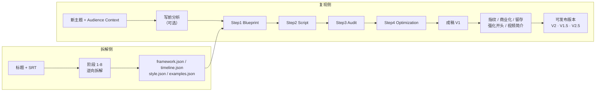

# YouTube 爆款文案逆向工程与复现系统

把一条已经跑量的 YouTube 视频（标题 + SRT 字幕）逆向拆成**可计算、可检索、可复核的四层资产**，再用四阶段管线为**新主题**产出「结构同源、表达原创」的成稿。

系统不做出字幕换词式改写：它保留的是可迁移的结构、节奏与表达机制，并保留每条结论回指原文的证据。

本仓库包含三部分：**拆解框架**（阶段 1-8）、**成稿管线**（四阶段 + 十五个外挂模块）、**提示词全集**。

---

## 总览



拆解与复现是**两条独立分支**：拆解回答「这条视频为什么有效」，复现回答「新主题能不能套用这个框架」。仓库同时给出两条分支的实现。

---

## 目录结构

```
.
├── app/                    生成平台（Node.js，零第三方依赖）
│   ├── voices/             频道声音设定（仅模板入库）
│   ├── server.js           HTTP 服务（API + 静态页）
│   ├── lib/                管线与各检查模块
│   ├── bin/                留存卡批量构建 CLI
│   ├── prompts/            现行提示词（生产用，单一来源）
│   ├── public/             前端 SPA
│   ├── data/runs/          80 条生成记录（含每步 attempts 与校验明细）
│   ├── data/logs/          运行日志（失败样本、留存卡批处理、探针输出）
│   └── config.example.json 配置结构示例（不含真实 Key）
├── assets/                 210 个四层资产包，每包含原始 SRT 与留存卡
├── baselines/              v1-v3 历史基线（提示词快照 + 产物 + 归因）
├── docs/                   阶段 1-8 工作流文档（v1.1 docx + 文本版 + 使用流程）
└── AGENTS.md               SRT 入库前置质检约定
```

---

## 一、拆解框架：阶段 1-8

输入是**标题 + 合法 SRT**（封面、CTR、留存曲线等只作可选增强），输出是同一 `asset_bundle_id` 下的四个 JSON。默认批处理模式不要求逐阶段确认，但每阶段都落一份可追溯的中间结果。

| 阶段 | 名称 | 产出 |
|---|---|---|
| 1 | 输入准入、SRT 标准化与定性卡片 | `normalized_cues`、`qualitative_card`、标题信息 |
| 2 | 功能结构骨架提取 | 章节功能骨架与边界 |
| 3 | 标题—开头 Hook 契约分析 | 标题承诺与开头履约的对应关系 |
| 4 | Retention Map 与 Timeline 事实层 | 绝对时间 + 归一化时间的节奏事实 |
| 5 | 三线推进与爆点分布 | 主线/副线/情绪线的推进与爆点位置 |
| 6 | Open Loop、悬念账本与回报闭环 | 埋设、延宕、回收的账本 |
| 7 | Voice Bible 与 Reference Example 候选集 | 语言人格、句式、节奏、禁用规则、候选样本 |
| 8 | 结尾机制分析、四层标准化与导出 | 四个目标 JSON |

### 四层资产

| 资产 | 回答的问题 | 主要来源 |
|---|---|---|
| `framework.json` | 为什么有效 | 阶段 1-3、5-6、8 |
| `timeline.json` | 何时发生、节奏如何 | SRT + 阶段 2-6 |
| `style.json` | 如何表达 | 阶段 7 + 全文证据 |
| `examples.json` | 真实感觉如何校准 | 阶段 3、5、7、8 |

### 硬性约定

- **单条视频的产出只能是 `candidate`**。只有在多个案例或真实 CTR / 留存 / 观看时长数据支持后，才能升级为 `validated`；不把单条爆款直接认定为已验证的通用框架。
- 阶段 2-7 的关键结论带 `evidence_refs`，能回指具体 SRT cue 或时间段。
- 阶段 8 只做标准化与导出，并通过 JSON Schema、跨文件 ID、时间覆盖和枚举校验。
- 入库前必须先做**结尾截断检测**：末句没有终止标点、在句子中间戛然而止的 SRT 一律不分析、不入库（见 `AGENTS.md`）。残缺文本会让 closure 分析、主承诺兑现判断和全部归一化比例尺失真。

阶段 1-8 的完整定义、字段规范与验收清单见 `docs/`：

- `爆款文案逆向工程系统_阶段1-8工作流_重构版_v1.1.docx`（现行版：阶段 8 增加留存卡输出，见文档开头「v1.1 修订说明」）
- `爆款文案逆向工程系统_阶段1-8工作流_重构版_v1.0.docx`（原件，留档）
- `extracted_workflow.txt`（同一份内容的纯文本版，1252 行）
- `使用流程_v1.1.html`（从建任务到出稿的操作路径，配 `images/` 下 16 张截图，浏览器直接打开）

### 资产包结构

`assets/<slug>/` 下固定 6 个文件，外加 v1.1 的留存卡：

```
framework.json   机制层
timeline.json    时间层
style.json       表达层
examples.json    样本层
meta.json        资产元信息（asset_bundle_id、来源、状态）
source.srt       源字幕
retention_cards.json  留存卡（v1.1，每段 7 项；node app/bin/build_retention_cards.js 生成，可人工修改）
```

`assets/_library/` 是全部留存卡汇总出的留存功能替换库（按高峰类型归类），由 `node app/bin/build_retention_cards.js --library` 重建，不是资产。

---

## 二、成稿管线

`app/lib/pipeline.js` 顺序执行四步，每步都把上一步产物 + 对应资产层喂给模型：

0. **写前分析（可选，建任务时勾选）**：写稿前先判断「新题目能不能用这个框架写」，产出结论、候选标题、论点卡、事实表（带年份与时效）、模块取舍、留存地图、钩子候选。任务停在「待确认分析」，人工核对（可直接改表格或补资料重跑）后确认，分析结果通过 `{{analysis}}` 注入下面四步。
   - 结论分三种：可以写 / 调整后可写（框架不动，只调题目侧）/ 换框架，并给出 `adjustments` 调整清单与 `reframe_reasons`。
   - **AI 先调整**（`prompts/adjust.md`）：补待查、改论点卡、为不可删段与高峰找事实、补候选标题；改动标蓝并记录依据（查到 / 估算 / 记忆待核 / 推理），可一键恢复。
   - **我的意见**（`prompts/revise.md`）：只重做提意见的那一行，返回改前改后，人工点采用才写入。
   - **标题审核**（`prompts/title_audit.md`）：自写标题先过审，通过后同步观众问题与期待方向。
   - **联网搜索**（`lib/search.js`）：AI 先列查询词（`prompts/adjust_queries.md`），程序检索取前 N 条，AI 只能按结果填并带链接与日期。
1. **Blueprint**：只做结构映射，不创作新结构；每章必须有功能、目标、Open Loop。
2. **Script**：按蓝图逐章施工；资产优先级为 Blueprint > Examples > Style > Audience Context。
3. **Audit**：逐项对照四层资产找偏差，结论必须引用证据；不依赖模型记忆。
4. **Optimization**：Preservation Editing，只修问题、不重写；输出 Change Log。

成稿后可跑**稿件检查**（`lib/analysis.js` + `prompts/script_check.md`），按 K1-K5 找问题：只找问题、不加新内容，结果支持一键采用。

### 先写后改（默认模式，当前 v1.8）

新建任务默认走 draft-first：分析 → AI 先调整（可联网）→ 自动确认 → 四步写稿 → 稿件检查 → **事实审计 + 联网核验**（`fact_audit.md` / `fact_verify.md`，拆主张、标风险、按证据定级，E 级必改、C/D 收窄）→ **初稿检查出二稿**（`prompts/draft_check.md`）→ **二稿逆向审稿报告**（`prompts/reverse_audit.md`，逐段对照审稿的报告页，停下等人勾选问题、选路线 A/B/C、选赛道）→ **终审三步出终稿** → 中文对照。

- 终审 = 独立审稿（`prompts/final_audit.md`，七维评分 + P0–P3 清单，只审不改）→ 按诊断修改（`prompts/final_revise.md`，逐处「原句→改成+理由」，程序定位替换拼出终稿）→ 独立复审（`prompts/final_recheck.md`，未达标自动补改一轮再复审，最多两轮）。三步分开调用，避免模型一边写一边替自己的问题辩护。
- 终审按赛道换提示词（`prompts/final_tracks/`：经济拆账 / 历史与古人 / 心理与动物科普 / POV 与等级沉浸 / 通用），替换维度 4 的审查内容、频道定位与留存重点；默认取写前分析匹配到的赛道卡，人可在审稿报告页改。
- 终稿页「终稿全文修订」：整页全文划线标每处改动（附原句中文、改后中文、理由），顶部有赛道、复审结论与修改前后七维评分对照；可只看终稿 / 复制纯净版 / 每章附整章中文。找不到原句或重叠的修改不采用并单列；找不到原句的修改会自动把那几章发回 AI 逐字重抄原句后再套一次。
- **去AI感**（终稿之后，可选）：选赛道后 AI 诊断终稿里机械、重复、模板化的位置（A–K 类型，标 P0/P1/P2/保留），每处给 3–5 种改法（含删掉这句），附中文和思路；人逐处勾选改法后按选择替换，存为 d4「去AI感稿」版本，重新应用从终稿重来不叠加。
- 版本留档：初稿 / 二稿 / 终稿（d1/d2/d3）存在任务里，可逐章对比任意相邻两版；终稿之后没人手动改过稿，重新终审从二稿重改，不叠改。
- 单章可「通过 / 提意见重写 / 压成过渡 / 撤回」；改事实会级联重写受影响的段。
- 篇幅闸门（上限 115%、下限默认 50%、韩文 25%，另设警告线）、章节标签畸形检出与章数对账（少章直接判不合格）、多语言分词查重（中日韩 12 字、英文 6 词）、提示词带当天日期、账本程序核算（`id/amount/formula`，对不上以程序为准并标红）、反转验证。

### 内置质量闸门

- 蓝图：字段查重；JSON 解析失败 / 输出过短 / 总时长 ≠ `video_goal` 时反馈重试一次，仍不合格置失败。
- 脚本：n-gram 查重（对源 SRT 与 examples）、每章词密度对账；`max_tokens` 截断时退到章节边界续写（最多「蓝图章数 + 2」轮），合并后校验章数、时间衔接与末章时长。章节标签时间字段缺失或乱填（如 `[CH13 | 미할당 | cta_outro]`）不再被静默跳过，直接判格式不合法；解析到的章数少于蓝图章数判「章节不全」，重试后仍不合格置 failed，不进入审核。篇幅需同时满足上限与下限，`checks.gate_fail` 记录失败原因并在详情页可见。
- 审核：输出非合法 JSON 自动反馈重试；`evidence_quote` 需逐字存在于脚本。
- 终稿：元评论 / 占位符检测、Change Log 的 `before` 逐字校验、时间轴漂移检测、章节结构闸门。
- 传输层：中转渠道可能把「被截断的流 + 完整流」塞进同一响应体，`parseSSE` 按流边界分段并取最长的一段，再由章节结构闸门二次把关。

### 章节标签规范

唯一合法形态，整行独占，不加粗、不加标题符：

```
[CH01 | 0:00-0:41 | promise_setup]
```

归一化只在入库边界做一次（`lib/textnorm.js`），各解析器保持严格。时间字段必须是 `m:ss` 或 `h:mm:ss`；写成「미할당」「待定」这类内容会判格式不合法，不再被解析器静默丢弃。

**纯净稿不变量**：推送到视频站的正文必须与「下载纯净稿」逐字节相同。前端 `cleanScriptText`（作用于 DOM 文本）与服务端 `video.cleanScript`（作用于 run 原始字段）是同一套规则的两份实现，改任意一处必须同步另一处，否则同一版本会在两处呈现不同内容。

### 可选步骤与外挂模块

| 模块 | 作用 |
|---|---|
| 写前分析 | 写稿前判定题目与框架是否匹配，产出论点卡、事实表、留存地图与钩子候选；支持 AI 先调整、逐行修订、标题审核，人工确认后才进入四步 |
| 联网搜索 | 按写前分析列出的查询词检索（渠道适配器，当前接 DeepSeek），只允许模型引用检索结果并附链接与日期 |
| 稿件检查 | 按 K1-K5 检查成稿的问题，只提出问题、不改写风格，结果可一键采用 |
| 逐段对照审稿 | 原片 / 模板 / 新稿对照 + 版本链审稿：初稿检查出二稿、二稿逆向审稿报告（勾选问题/选路线/选赛道，逐条预估加分）、终审三步（审稿→修改→复审）出终稿、全文修订页划线展示每处改动；旧任务保留单章通过/重写/压过渡/撤回 |
| 去AI感 | 终稿后可选：诊断模板化表达（A–K 类型 + P0/P1/P2），每处给 3–5 种改法附中文，人勾选后按选择替换并存为 d4 版本；赛道保护项（DEAI_PROTECT）防止误伤事实与结构 |
| 中文对照 | 新稿与各版本改动的中文翻译，按文本哈希缓存（同任务内自动去重），供审稿视图使用 |
| 留存卡 | 每段 7 项（段与位置、持有的高峰、悬念、原片做法、抽象动作、替换条件、可删性），前三项程序对齐、后三项可 AI 重写，落在 `assets/<id>/retention_cards.json` |
| 频道声音 | 语体、称呼观众、自称、风格、固定用语，注入写前分析与 step2 / step4 |
| 指纹检测与替换 | 检测「俗见反转 / 泛称主语 / 无人告知 / 转折拐杖」四类爆款声音指纹，逐条改写，产出 V1.5 / V2.5 |
| YouTube 商业化检查 | 按目标语言检查可口播性、敏感表述与商业化风险，逐条定位替换 |
| 开头留存检查 | 锁定前 60 秒，检查现象/冲突/本质与价值承诺，两个 10 分制评分 + 可定位命中 |
| 强化开头 | 以源爆款开头为模板，对指定章节做逐句 1:1 仿写并机械拼接（词数 ±15% 闸门） |
| 视频简介生成 | 钩子段 + TIMESTAMPS + 要点 + 收尾 + 订阅引导 + 免责声明，骨架由代码按语言包拼接 |
| 选题推荐 | 结合赛道与已验证框架，生成 5 个高点击选题 |
| 外文纯净 | 非中文稿混入的汉字/日文假名：规则修（括号注释、汉字数字、万→千位）+ 模型逐行改写兜底，挂在各写稿/审稿环节保存前；中文/日文目标稿豁免 |
| YouTube 数据抓取 | `extension/` Chrome 插件在 Studio 数据页一键抓取指标与留存曲线，按标题/视频 ID 匹配任务；详情页「真实数据」卡：曲线画章节位置、每章流失、掉人最多的句子、下载分析包 |
| 听感与语速闸门 | 听感检查（前 8 秒标题说法、前 10 秒数字 ≤1、一句 ≤2 个数字、语体混用）挂 Step2/Step4 不合格反馈重写一次；审稿各环节不许把稿子改长（整篇 +3%、前 2 分钟只许删换）；篇幅按真实配音语速（narration_wpm → 已发布实测 → 语言默认 → 原片语速） |

---

## 三、提示词全集

现行提示词在 `app/prompts/`，是**生产用单一来源**：改这里即改管线，不存在第二份副本。

| 文件 | 用途 | 行数 |
|---|---|---|
| `analysis.md` | 写前分析（题目与框架匹配、论点卡、事实表） | 108 |
| `adjust.md` | AI 先调整（补待查、改论点、找事实、补标题） | 84 |
| `adjust_queries.md` | 生成联网搜索查询词 | 21 |
| `revise.md` | 按人工意见只重做一行 | 29 |
| `title_audit.md` | 自写标题审核 | 26 |
| `step1.md` | Blueprint 生成 | 89 |
| `step2.md` | 脚本施工 | 52 |
| `step3.md` | 质量审核 | 71 |
| `step4.md` | 终稿优化 | 58 |
| `step5.md` | 开头逐句仿写（强化开头） | 27 |
| `script_check.md` | 稿件检查 K1-K5 | 38 |
| `draft_check.md` | 初稿检查出二稿 | 56 |
| `fact_audit.md` | 事实审计（拆主张、标风险、给搜索词） | 51 |
| `fact_verify.md` | 联网核验（按证据定级 A–E，必改或收窄） | 54 |
| `reverse_audit.md` | 二稿逆向工程审稿报告（九部分 + 逐条预估加分） | 523 |
| `final_audit.md` | 终审①独立审稿（七维评分 + P0–P3 清单） | 223 |
| `final_revise.md` | 终审②按诊断修改（逐处原句→改成+理由） | 85 |
| `final_recheck.md` | 终审③独立复审（评分对照，未达标补改一轮） | 71 |
| `final_patch.md` | 按复审 OPEN 清单补改终稿 | 57 |
| `final_open_extract.md` | 从旧复审报告里抽出 OPEN 待改清单 | 17 |
| `final_fix_quotes.md` | 原句定位失败时让模型对照原章逐字重抄 | 20 |
| `foreign_fix.md` | 外文稿混入汉字/假名的整行改写（规则修兜底） | 20 |
| `final_tracks/*.md` | 终审与去AI感赛道配置（经济拆账/历史与古人/心理与动物科普/POV/通用） | 202 |
| `deai_diagnose.md` | 去AI感诊断（A–K 类型、P0/P1/P2、每处 3–5 种改法） | 110 |
| `rewrite_segment.md` | 单章按意见重写（对照审稿） | 42 |
| `translate.md` | 中文对照翻译（按文本哈希去重） | 12 |
| `retention_card.md` | 留存卡后三项文字重写 | 15 |
| `track_cards.md` | 赛道卡（各赛道的必备事实与查证路径） | 34 |
| `voice_draft.md` | 频道声音设定起草 | 20 |
| `fingerprint_detect.md` | 爆款声音指纹检测与改写 | 42 |
| `fingerprints.json` | 指纹模式库（各语言正则 + 结构判定要点） | — |
| `compliance_check.md` | YouTube 商业化检查 | 287 |
| `opening_retention_check.md` | 开头留存检查 | 126 |
| `description.md` | 视频简介素材 | 42 |
| `topics.md` | 选题推荐 | 59 |

合计 33 份 `.md`（2569 行）+ `final_tracks/` 5 份（202 行）+ `fingerprints.json` 模式库；物理文件 38 份，合计 2771 行。

### 历史版本

`baselines/v1|v2|v3/` 各存 4 份提示词快照与对应产物，用于回归对照：

- **v1**：修复前基线，含 D1-D7 缺陷表与归因分析。
- **v2**：第一/二梯队修复后复测。
- **v3**：验证三项修复——P1 全片总时长硬约束、P4 词数区间改为 90%-110%、P2 原创性豁免必须举证 `pattern_id`。

**生产环境用的是 `app/prompts/`**（其 step1-4 即 v3 版管线提示词）。`baselines/` 仅作历史留档，不要直接拿去跑。

### 提示词设计要点

- 角色化开头 + 明确「你没有可信的记忆」这类约束，把审核步从「凭感觉」压到「必须举证」。
- 模板变量用 `{{script}}`、`{{blueprint}}` 这类显式占位，避免模型把说明文字当正文。
- 语言相关：生成内容跟随任务的 `audience.target_language`，分析说明保持中文；商业化替换正文语言缺失时直接报错，不从原文推断。

---

## 四、快速开始

```bash
# 1. 复制配置示例并填入自己的 Key
cp app/config.example.json app/config.json

# 2. 启动（默认 8080，可用 PORT 覆盖）
node app/server.js
```

- 本机：http://localhost:8080
- 局域网：http://<本机IP>:8080（启动时会打印）

零第三方依赖，无需 `npm install`；实测 Node.js v22.22.2。前端为 `app/public/` 下的静态 SPA，由 `server.js` 直接读盘服务（新增静态资源类型需同步补 `server.js` 里的 MIME 白名单）。

---

## 五、安全与边界

**本仓库不包含**：

- `app/config.json`：7 个渠道的明文 API Key，仅保留结构示例 `app/config.example.json`。
- `app/data/video_binding.json`：视频站账号、密码与 token。
- `tools/`：SRT 质检、批处理、校验与迁移脚本（未随仓库发布，README 中出现的 `tools/xxx` 路径因此不可用）。
- `new_source/`：待拆解的新字幕。
- `claude-优化方案/`：外部补丁包与原始材料，非本仓库产物。
- `app/voices/*.json`：本机频道声音配置，只保留 `_template.json`。
- `.workbuddy/`：内部工作区。

**运行日志（已入库）**：

`app/data/logs/` 按约定公开，用于复现问题与核对批处理结果：

| 文件 | 内容 |
|---|---|
| `retention_ai_20261022.log` | 留存卡 AI 润色的逐资产进度与失败回退记录（179 个资产） |
| `compliance_fail_*.txt` | 商业化检查被模型拒绝时的原始返回（失败样本） |
| `opening_fail_*.txt` | 开头留存检查失败时的原始返回 |
| `probes/*.txt` | 开头留存检查的模型原始输出（按 run + 版本存） |

每个任务的 `attempts`、`checks`、`steps` 明细在 `app/data/runs/<id>.json` 内，与日志互为补充。

**版权**：

`assets/` 与 `baselines/` 内含第三方 YouTube 视频的字幕原文及其衍生结构分析，版权归原视频作者所有。此处仅用于研究与学习，**不得再分发或商用**。如需引用其中的框架结论，请自行核实来源与授权。

**质量**：

`audit` 输出的 `factual_claims` 默认是「未核实」状态，`baselines` 中的批量产物同样如此。发布前必须人工逐条核对事实，模型不会替你担保。

---

## 六、许可

本仓库未附开源许可证，保留所有权利。转载、引用或商用请先联系作者。

## 七、联系

邮箱：1520254532@qq.com
