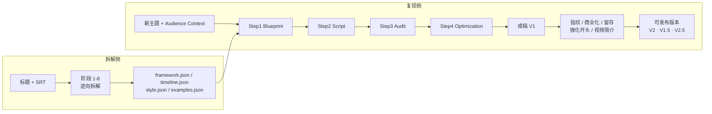

# YouTube 爆款文案逆向工程与复现系统

把一条已经跑量的 YouTube 视频（标题 + SRT 字幕）逆向拆成**可计算、可检索、可复核的四层资产**，再用四阶段管线为**新主题**产出「结构同源、表达原创」的成稿。

系统不做出字幕换词式改写：它保留的是可迁移的结构、节奏与表达机制，并保留每条结论回指原文的证据。

本仓库包含三部分：**拆解框架**（阶段 1-8）、**成稿管线**（四阶段 + 六个外挂模块）、**提示词全集**。

---

## 总览



拆解与复现是**两条独立分支**：拆解回答「这条视频为什么有效」，复现回答「新主题能不能套用这个框架」。仓库同时给出两条分支的实现。

---

## 目录结构

```
.
├── app/                    生成平台（Node.js，零第三方依赖）
│   ├── voices/             频道声音设定（每个频道一份 JSON）
│   ├── server.js           HTTP 服务（API + 静态页）
│   ├── lib/                管线与各检查模块
│   ├── prompts/            现行提示词（生产用，单一来源）
│   ├── public/             前端 SPA
│   ├── data/runs/          50 条生成记录
│   └── config.example.json 配置结构示例（不含真实 Key）
├── assets/                 127 个四层资产包，每包含原始 SRT
├── baselines/              v1-v3 历史基线（提示词快照 + 产物 + 归因）
├── docs/                   阶段 1-8 工作流文档（docx + 文本版）
└── AGENTS.md               SRT 入库前置质检约定
```

---

## 一、拆解框架：阶段 1-8

输入是**标题 + 合法 SRT**（封面、CTR、留存曲线等只作可选增强），输出是同一 `asset_bundle_id` 下的四个 JSON。默认批处理模式不要求逐阶段确认，但每阶段都落一份可追溯的中间结果。

| 阶段 | 名称 | 产出 |
|---|---|---|
| 1 | 输入准入、SRT 标准化与定性卡片 | `normalized_cues`、`qualitative_card`、标题信息 |
| 2 | 功能结构骨架提取 | 章节功能骨架与边界 |
| 3 | 标题—开头 Hook 契约分析 | 标题承诺与开头履约的对应关系 |
| 4 | Retention Map 与 Timeline 事实层 | 绝对时间 + 归一化时间的节奏事实 |
| 5 | 三线推进与爆点分布 | 主线/副线/情绪线的推进与爆点位置 |
| 6 | Open Loop、悬念账本与回报闭环 | 埋设、延宕、回收的账本 |
| 7 | Voice Bible 与 Reference Example 候选集 | 语言人格、句式、节奏、禁用规则、候选样本 |
| 8 | 结尾机制分析、四层标准化与导出 | 四个目标 JSON |

### 四层资产

| 资产 | 回答的问题 | 主要来源 |
|---|---|---|
| `framework.json` | 为什么有效 | 阶段 1-3、5-6、8 |
| `timeline.json` | 何时发生、节奏如何 | SRT + 阶段 2-6 |
| `style.json` | 如何表达 | 阶段 7 + 全文证据 |
| `examples.json` | 真实感觉如何校准 | 阶段 3、5、7、8 |

### 硬性约定

- **单条视频的产出只能是 `candidate`**。只有在多个案例或真实 CTR / 留存 / 观看时长数据支持后，才能升级为 `validated`；不把单条爆款直接认定为已验证的通用框架。
- 阶段 2-7 的关键结论带 `evidence_refs`，能回指具体 SRT cue 或时间段。
- 阶段 8 只做标准化与导出，并通过 JSON Schema、跨文件 ID、时间覆盖和枚举校验。
- 入库前必须先做**结尾截断检测**：末句没有终止标点、在句子中间戛然而止的 SRT 一律不分析、不入库（见 `AGENTS.md`）。残缺文本会让 closure 分析、主承诺兑现判断和全部归一化比例尺失真。

阶段 1-8 的完整定义、字段规范与验收清单见 `docs/`：

- `爆款文案逆向工程系统_阶段1-8工作流_重构版_v1.1.docx`（现行版：阶段 8 增加留存卡输出，见文档开头「v1.1 修订说明」）
- `爆款文案逆向工程系统_阶段1-8工作流_重构版_v1.0.docx`（原件，留档）
- `extracted_workflow.txt`（同一份内容的纯文本版，1252 行）

### 资产包结构

`assets/<slug>/` 下固定 6 个文件，外加 v1.1 的留存卡：

```
framework.json   机制层
timeline.json    时间层
style.json       表达层
examples.json    样本层
meta.json        资产元信息（asset_bundle_id、来源、状态）
source.srt       源字幕
retention_cards.json  留存卡（v1.1，每段 7 项；node app/bin/build_retention_cards.js 生成，可人工修改）
```

`assets/_library/` 是全部留存卡汇总出的留存功能替换库（按高峰类型归类），由 `node app/bin/build_retention_cards.js --library` 重建，不是资产。

---

## 二、成稿管线

`app/lib/pipeline.js` 顺序执行四步，每步都把上一步产物 + 对应资产层喂给模型：

1. **Blueprint**：只做结构映射，不创作新结构；每章必须有功能、目标、Open Loop。
2. **Script**：按蓝图逐章施工；资产优先级为 Blueprint > Examples > Style > Audience Context。
3. **Audit**：逐项对照四层资产找偏差，结论必须引用证据；不依赖模型记忆。
4. **Optimization**：Preservation Editing，只修问题、不重写；输出 Change Log。

### 内置质量闸门

- 蓝图：字段查重；JSON 解析失败 / 输出过短 / 总时长 ≠ `video_goal` 时反馈重试一次，仍不合格置失败。
- 脚本：n-gram 查重（对源 SRT 与 examples）、每章词密度对账；章节结构不合格或 `max_tokens` 截断时退到章节边界续写（最多 2 轮），合并后校验章数、时间衔接与末章时长。
- 审核：输出非合法 JSON 自动反馈重试；`evidence_quote` 需逐字存在于脚本。
- 终稿：元评论 / 占位符检测、Change Log 的 `before` 逐字校验、时间轴漂移检测、章节结构闸门。
- 传输层：中转渠道可能把「被截断的流 + 完整流」塞进同一响应体，`parseSSE` 按流边界分段并取最长的一段，再由章节结构闸门二次把关。

### 章节标签规范

唯一合法形态，整行独占，不加粗、不加标题符：

```
[CH01 | 0:00-0:41 | promise_setup]
```

归一化只在入库边界做一次（`lib/textnorm.js`），各解析器保持严格。

### 六个外挂模块

| 模块 | 作用 |
|---|---|
| 指纹检测与替换 | 检测「俗见反转 / 泛称主语 / 无人告知 / 转折拐杖」四类爆款声音指纹，逐条改写，产出 V1.5 / V2.5 |
| YouTube 商业化检查 | 按目标语言检查可口播性、敏感表述与商业化风险，逐条定位替换 |
| 开头留存检查 | 锁定前 60 秒，检查现象/冲突/本质与价值承诺，两个 10 分制评分 + 可定位命中 |
| 强化开头 | 以源爆款开头为模板，对指定章节做逐句 1:1 仿写并机械拼接（词数 ±15% 闸门） |
| 视频简介生成 | 钩子段 + TIMESTAMPS + 要点 + 收尾 + 订阅引导 + 免责声明，骨架由代码按语言包拼接 |
| 选题推荐 | 结合赛道与已验证框架，生成 5 个高点击选题 |

---

## 三、提示词全集

现行提示词在 `app/prompts/`，是**生产用单一来源**：改这里即改管线，不存在第二份副本。

| 文件 | 用途 | 行数 |
|---|---|---|
| `step1.md` | Blueprint 生成 | 63 |
| `step2.md` | 脚本施工 | 34 |
| `step3.md` | 质量审核 | 61 |
| `step4.md` | 终稿优化 | 40 |
| `step5.md` | 开头逐句仿写（强化开头） | 27 |
| `fingerprint_detect.md` | 爆款声音指纹检测与改写 | 42 |
| `fingerprints.json` | 指纹模式库（各语言正则 + 结构判定要点） | — |
| `compliance_check.md` | YouTube 商业化检查 | 285 |
| `opening_retention_check.md` | 开头留存检查 | 120 |
| `description.md` | 视频简介素材 | 42 |
| `topics.md` | 选题推荐 | 59 |

### 历史版本

`baselines/v1|v2|v3/` 各存 4 份提示词快照与对应产物，用于回归对照：

- **v1**：修复前基线，含 D1-D7 缺陷表与归因分析。
- **v2**：第一/二梯队修复后复测。
- **v3**：验证三项修复——P1 全片总时长硬约束、P4 词数区间改为 90%-110%、P2 原创性豁免必须举证 `pattern_id`。

**生产环境用的是 `app/prompts/`**（其 step1-4 即 v3 版管线提示词）。`baselines/` 仅作历史留档，不要直接拿去跑。

### 提示词设计要点

- 角色化开头 + 明确「你没有可信的记忆」这类约束，把审核步从「凭感觉」压到「必须举证」。
- 模板变量用 `{{script}}`、`{{blueprint}}` 这类显式占位，避免模型把说明文字当正文。
- 语言相关：生成内容跟随任务的 `audience.target_language`，分析说明保持中文；商业化替换正文语言缺失时直接报错，不从原文推断。

---

## 四、快速开始

```bash
# 1. 复制配置示例并填入自己的 Key
cp app/config.example.json app/config.json

# 2. 启动（默认 8080，可用 PORT 覆盖）
node app/server.js
```

- 本机：http://localhost:8080
- 局域网：http://<本机IP>:8080（启动时会打印）

零第三方依赖，无需 `npm install`；实测 Node.js v22.22.2。前端为 `app/public/` 下的静态 SPA，由 `server.js` 直接读盘服务（新增静态资源类型需同步补 `server.js` 里的 MIME 白名单）。

---

## 五、安全与边界

**本仓库不包含**：

- `app/config.json`：7 个渠道的明文 API Key，仅保留结构示例 `app/config.example.json`。
- `app/data/video_binding.json`：视频站账号、密码与 token。
- `tools/`：SRT 质检、批处理、校验与迁移脚本（未随仓库发布，README 中出现的 `tools/xxx` 路径因此不可用）。
- `new_source/`：待拆解的新字幕。
- `app/data/logs/`、`.workbuddy/`：运行时日志与内部工作区。

**版权**：

`assets/` 与 `baselines/` 内含第三方 YouTube 视频的字幕原文及其衍生结构分析，版权归原视频作者所有。此处仅用于研究与学习，**不得再分发或商用**。如需引用其中的框架结论，请自行核实来源与授权。

**质量**：

`audit` 输出的 `factual_claims` 默认是「未核实」状态，`baselines` 中的批量产物同样如此。发布前必须人工逐条核对事实，模型不会替你担保。

---

## 六、许可

本仓库未附开源许可证，保留所有权利。转载、引用或商用请先联系作者。

## 七、联系

邮箱：1520254532@qq.com
